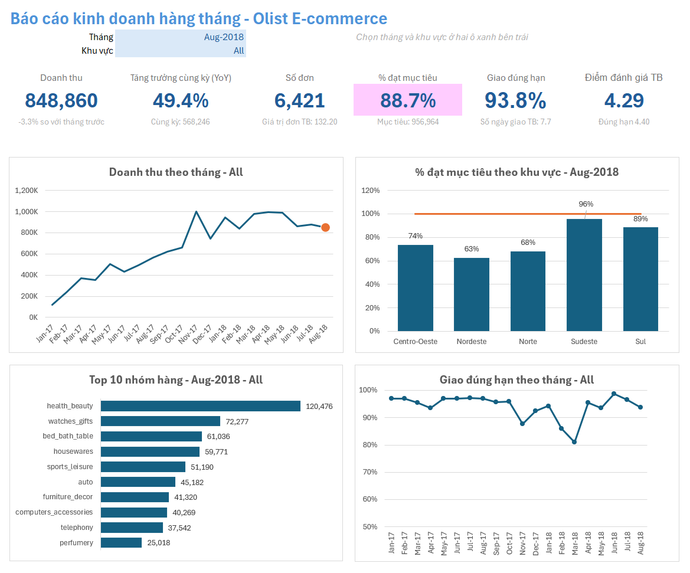
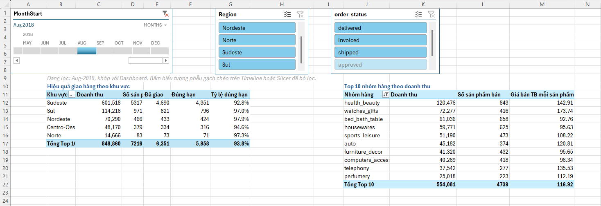
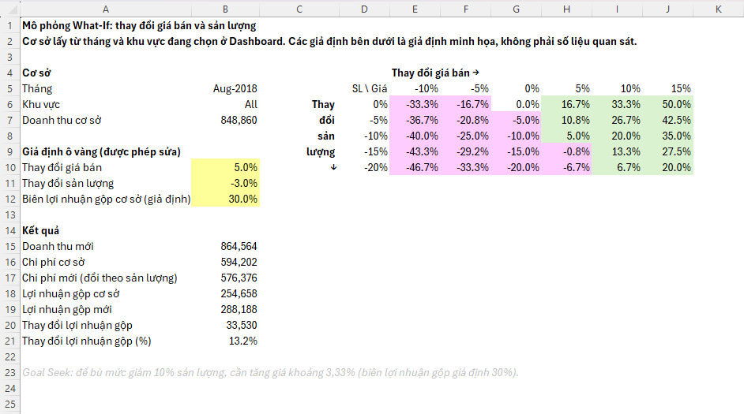

# Báo cáo kinh doanh hàng tháng tự động trên Excel (dữ liệu Olist)

Một file Excel dùng dữ liệu thật của sàn thương mại điện tử Olist (Brazil). Power Query đọc nhiều file CSV, làm sạch và ghép thành một bảng, công thức Excel tính các chỉ số kinh doanh, và một Dashboard có hai ô chọn **tháng** và **khu vực**: chọn xong, toàn bộ thẻ KPI và biểu đồ tự cập nhật.



> **Cần Microsoft Excel 365 hoặc 2021 trở lên** (dùng XLOOKUP và các hàm mảng động như UNIQUE, FILTER, SORTBY, TAKE). File mở bằng WPS hoặc Excel bản cũ sẽ không chạy đầy đủ.

## Bài toán

Quản lý kinh doanh của một sàn thương mại điện tử cần, mỗi tháng:

1. Doanh thu bao nhiêu, tăng giảm thế nào so với tháng trước và cùng kỳ, so với mục tiêu?
2. Khu vực và nhóm hàng nào kéo doanh thu?
3. Giao hàng có đúng hẹn không, và có ảnh hưởng đến đánh giá của khách không?
4. Nếu thay đổi giá bán thì doanh thu và lợi nhuận thay đổi thế nào?

## Kết quả chính

Số liệu cho giai đoạn **01/2017 đến 08/2018** (các tháng 2016 và 09/2018 rất ít đơn nên không đưa vào báo cáo). Tiền tệ BRL.

| Chỉ số | Giá trị |
|---|---|
| Tổng doanh thu trong khoảng báo cáo | 13.449.530 |
| Tổng số đơn trong khoảng báo cáo | 97.905 |
| Doanh thu tháng cao nhất (11/2017) | 1.003.862 (7.421 đơn) |
| Doanh thu tháng 08/2018 | 848.860 (6.421 đơn, +49,4% so với cùng kỳ) |

**Phát hiện (trên dữ liệu thật, tương quan chứ chưa phải nguyên nhân)**

- **Sudeste chiếm khoảng 65% doanh thu** (8,79 triệu), tiếp theo là Sul (14,4%), Nordeste (11,4%), Centro-Oeste (6,4%) và Norte (2,5%).
- **Tháng 11/2017 (Black Friday)** có doanh thu và số đơn cao nhất (tăng 52,1% so với tháng 10), nhưng giao đúng hạn chỉ **87,6%** (so với 93,8% ở 08/2018), thời gian giao trung bình **15,1 ngày** (so với 7,7 ngày) và điểm đánh giá **3,95** (so với 4,29).
- **Giao trễ gắn với đánh giá thấp:** ở 08/2018, đơn giao đúng hạn có điểm trung bình 4,40, đơn giao trễ chỉ 2,99, chênh khoảng 1,4 điểm.
- **Nhóm hàng:** 10 nhóm hàng đứng đầu chiếm khoảng 65,3% doanh thu 08/2018, đứng đầu là health_beauty (14,2%), watches_gifts (8,5%) và bed_bath_table (7,2%).
- **Mục tiêu (giả định tăng 5% so với trung bình 3 tháng trước):** 12 trên 17 tháng đạt từ 100% trở lên, hầu hết trong năm 2017. Các tháng 02/2018 và 06 đến 08/2018 đạt dưới 90%, cho thấy tăng trưởng đi ngang trong năm 2018.

**Đề xuất hành động (minh họa)**

1. Chuẩn bị năng lực vận chuyển trước mùa cao điểm tháng 11, vì tháng đông đơn nhất (11/2017) giao chậm hơn và có điểm đánh giá thấp hơn so với tháng 08/2018.
2. Ưu tiên cải thiện tỷ lệ giao đúng hạn, vì đơn trễ có điểm đánh giá thấp hơn khoảng 1,4 điểm.
3. Rà lại cách đặt mục tiêu: dùng trung bình 3 tháng gần nhất chưa tính mùa vụ nên làm sai lệch kết quả ở các tháng sau đỉnh (ví dụ tháng 12/2017 chỉ đạt 92,8% vì mục tiêu bị đẩy lên bởi tháng 11).
4. Tập trung nguồn lực vào Sudeste (khoảng 65% doanh thu), theo dõi riêng các khu vực nhỏ như Norte vì số liệu dao động mạnh.

## Cấu trúc file Excel

| Sheet | Nội dung |
|---|---|
| README | Hướng dẫn dùng, định nghĩa chỉ số, giả định, hạn chế |
| Dashboard | 2 ô chọn (tháng, khu vực), 6 thẻ KPI, 4 biểu đồ, nhận định |
| Pivots | 2 PivotTable với Slicer (khu vực, trạng thái đơn) và Timeline (tháng) |
| WhatIf | Mô phỏng thay đổi giá và sản lượng: Data Table hai chiều và Goal Seek |
| Assumptions | Các giả định (khoảng tháng báo cáo, tăng trưởng mục tiêu, ngưỡng đạt) |
| Calc, Calc_Region, Calc_Dash | Các sheet tính toán: theo tháng, theo khu vực, theo tháng và khu vực đang chọn |
| Lookup | Bảng tra: bang sang khu vực, danh sách chọn |
| Check | Các ô đối chiếu số liệu |
| Sales_Data | Bảng dữ liệu đã làm sạch (112.101 dòng) |




## Dữ liệu và làm sạch

- Nguồn: **Olist Brazilian E-Commerce Public Dataset** trên Kaggle: [ĐIỀN LINK DATASET VÀO ĐÂY](https://www.kaggle.com). Đây là dữ liệu thật đã ẩn danh. Các file CSV không được đưa lên repo, tải từ Kaggle nếu muốn làm mới.
- Dùng 6 file: orders, order_items, customers, products, product_category_name_translation, order_reviews.

| Việc làm trong Power Query | Lý do |
|---|---|
| Loại đơn bị hủy (canceled) và không có hàng (unavailable) | Không tạo ra doanh thu |
| Ghép đơn hàng với sản phẩm bằng Inner join | Các sản phẩm của đơn bị loại tự biến mất |
| Ghép khách hàng, sản phẩm, đánh giá bằng Left join | Không làm mất dòng nếu thiếu thông tin |
| Gom đánh giá về một điểm mỗi đơn (Group By, Average) | Một đơn có thể có nhiều đánh giá, ghép thẳng sẽ nhân dòng |
| Thêm cột OrderFlag (bằng 1 ở sản phẩm đầu tiên của mỗi đơn) | Tránh tính một đơn nhiều lần khi đếm đơn hoặc tính chỉ số theo đơn |
| Dịch tên nhóm hàng sang tiếng Anh, gán `unknown` cho nhóm trống | Báo cáo dễ đọc, không có nhóm không tên |
| Bảng tra bang sang khu vực (5 khu vực Brazil) | Phân tích theo khu vực |

Kết quả: bảng **Sales_Data 112.101 dòng** (mỗi dòng là một sản phẩm trong một đơn), 98.199 đơn.

## Định nghĩa chỉ số

| Chỉ số | Định nghĩa |
|---|---|
| Doanh thu | Tổng giá sản phẩm của các đơn không bị hủy (không gồm phí vận chuyển) |
| Số đơn | Số mã đơn khác nhau (đếm bằng OrderFlag) |
| Giao đúng hạn | Ngày giao thực tế nhỏ hơn hoặc bằng ngày hẹn giao, chỉ tính đơn đã giao |
| Mục tiêu (giả định) | Trung bình doanh thu 3 tháng liền trước x (1 + 5%), bỏ trống ba tháng đầu |
| % đạt mục tiêu | Doanh thu / mục tiêu, tô màu: xanh từ 100%, vàng từ 90%, hồng dưới 90% |

## Kỹ năng Excel thể hiện

| Kỹ năng | Dùng ở đâu |
|---|---|
| Power Query (Merge, Group By, cột tùy chỉnh) | Tạo bảng Sales_Data từ 6 file CSV |
| Excel Table và tham chiếu có cấu trúc | Mọi công thức dùng tên bảng thay cho địa chỉ ô |
| SUMIFS, COUNTIFS, AVERAGEIFS | Các bảng tính toán và thẻ KPI |
| XLOOKUP, INDEX và MATCH | Tra cứu mục tiêu theo tháng và khu vực |
| EDATE | So sánh tháng trước và cùng kỳ năm trước |
| UNIQUE, SORT, FILTER, SORTBY, TAKE, VSTACK, TRANSPOSE | Danh sách tháng, khu vực, top và bottom nhóm hàng tự cập nhật |
| Named Range, Data Validation | Ô chọn tháng và khu vực |
| Conditional Formatting | Tô màu % đạt mục tiêu theo ngưỡng |
| PivotTable, trường tính toán, Slicer, Timeline | Sheet Pivots |
| Data Table, Goal Seek | Sheet WhatIf |
| Biểu đồ nhiều loại, tiêu đề động | Dashboard |

## Kiểm chứng

- Tổng doanh thu theo 5 khu vực bằng tổng doanh thu theo tháng (13.449.530).
- Số liệu Dashboard khớp với PivotTable (hai cách tính độc lập), ví dụ 08/2018: 848.860 doanh thu, 6.421 đơn, 93,8% giao đúng hạn.
- Tổng doanh thu của mọi nhóm hàng bằng doanh thu của tháng đang chọn.
- Bảng Data Table ở sheet WhatIf khớp với kết quả tính tay bằng công thức.

## Hạn chế

- Mục tiêu doanh thu và biên lợi nhuận gộp (30%) là **giả định minh họa** vì dữ liệu gốc không có mục tiêu và giá vốn.
- Mục tiêu tính theo trung bình 3 tháng gần nhất, chưa tính mùa vụ.
- Một đơn có thể gồm nhiều nhóm hàng. Doanh thu theo nhóm hàng đúng, nhưng chỉ số "số đơn" theo từng nhóm hàng không dùng được vì OrderFlag chỉ gắn với sản phẩm đầu tiên của đơn.
- Khoảng 1,3% doanh thu thuộc các sản phẩm không có nhóm hàng (gán `unknown`). Tên nhóm hàng lấy nguyên văn từ dữ liệu gốc nên còn vài lỗi chính tả.
- Chỉ số giao hàng chỉ tính các đơn đã giao.
- Làm mới dữ liệu cần các file CSV ở đúng đường dẫn đã cài, xem phần dưới.

## Cấu trúc repo

```
.
├── README.md
├── Olist_Sales_Report.xlsx
├── docs/
│   └── formulas.md          # các bước Power Query và công thức chính
└── images/
    ├── demo.gif
    ├── dashboard_aug2018.png
    ├── dashboard_nov2017.png
    ├── pivots.png
    └── whatif.png
```

## Cách mở file

1. Mở `Olist_Sales_Report.xlsx` bằng Microsoft Excel 365. Dữ liệu đã nhúng sẵn trong file, nên Dashboard, PivotTable và WhatIf hoạt động ngay.
2. Nếu Excel hiện thanh cảnh báo bảo mật vàng "External Data Connections have been disabled", chỉ cần bấm **Enable Content** khi muốn làm mới dữ liệu.
3. Muốn **làm mới** (Data, Refresh All): tải các file CSV từ Kaggle, đặt vào một thư mục, rồi vào **Data** → **Get Data** → **Data Source Settings** → **Change Source** để trỏ lại đường dẫn từng file.
4. Chọn tháng và khu vực ở hai ô vàng của sheet Dashboard.
